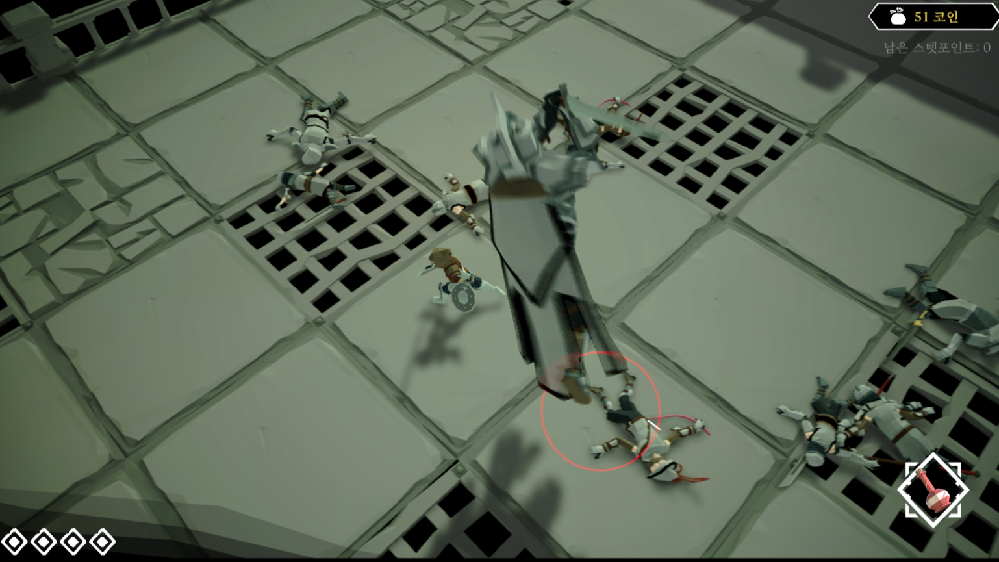
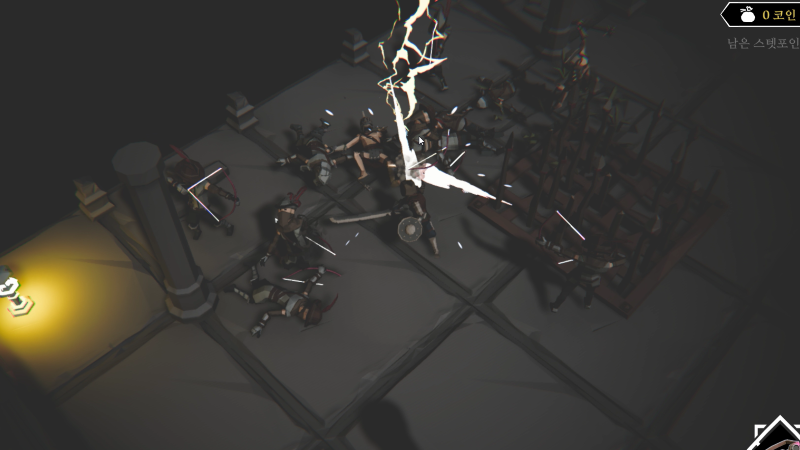
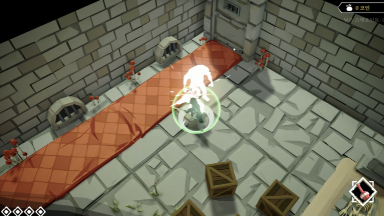

# Blade X

> 📌 하데스와 데스도어에서 영감을 받은, 매 도전마다 새롭게 성장하여 강력한 보스에 맞서는 로그라이크 액션 게임입니다.

<p align="left">
  
  
  
</p>

🔗 [문서](https://abaft-yarn-52e.notion.site/blade-x-1d5c32f25528803b96c3fd71d4189735)

이 폴더의 코드는 모두 제가 직접 작성한 부분입니다.

---

## 📂 폴더 구조

```
BladeX/
├── BT/          # Behavior Tree 노드 · 그래프
├── Combat/      # 공격 판정, 체력, 타격 연출
├── Enemy/       # 일반 적 · 보스
├── Skill/       # 스킬 (ScriptableObject)
├── Level/       # 스테이지 노드, 스포너
├── NPC/         # 장비 태그 변경 NPC
├── Particle/    # 파티클 · 풀링
└── Button/      # 메뉴 버튼
```

---

## 🔹 핵심 구조

### Enemy AI — `BT/`, `Enemy/`
- 이동·판단은 **Behavior Tree 노드**(`BT/`), 실제 동작·애니메이션은 **적 클래스**(`Enemy/`)로 분리해 의존성을 줄였습니다.
- 모든 적은 `BaseEnemy` / `BaseEnemyAnimationController`를 상속하며, 공통 노드를 재조합해 `BT/Graph/`의 적별 그래프를 구성합니다.
- 예: `GolemBoss : ThrowEnemy : BaseEnemy` 처럼 기존 적을 확장해 새 적을 빠르게 추가할 수 있습니다.

### 전투 — `Combat/`
- **Caster**: `ICasterAble.Cast()` 하나로 플레이어·적의 공격 판정을 통일. `LayerCaster`가 범위 · 장애물 검사 · 데미지 적용을 공통 처리합니다.
- **Health**: `IHealth`(`TakeDamage`, `TakeHeal`, `Dead`)를 기준으로 플레이어 · 일반 적 · 보스 체력을 확장합니다.
- **ActionData**: 피격 지점, 데미지, 스턴, 넉백, 패리 타입 등 전투 데이터를 하나의 구조체로 전달합니다.
- **Feedback**: `PlayFeedback()` / `ResetFeedback()` 추상 클래스로 타격감 연출을 컴포넌트 단위로 조합합니다.

### 스킬 — `Skill/`
- 스킬은 `SkillData`(ScriptableObject)를 상속해 구현하고, 발동 확률 · 색상 계열 · 파티클 등은 데이터로 조정합니다.
- `PlayerSkillController`가 `SkillType`별로 스킬 발동을 중앙에서 관리합니다.

### 레벨 — `Level/`
- `NodeList.cs`의 `NodeDictionary`가 일반 · 특수(상점, 도전, 휴식 등) · 보스 노드를 확률 기반으로 구성합니다.
- `Spawner` 추상 클래스가 웨이브 단위 스폰을 담당하며, Enemy와 독립적으로 동작해 개별 테스트가 가능합니다.
