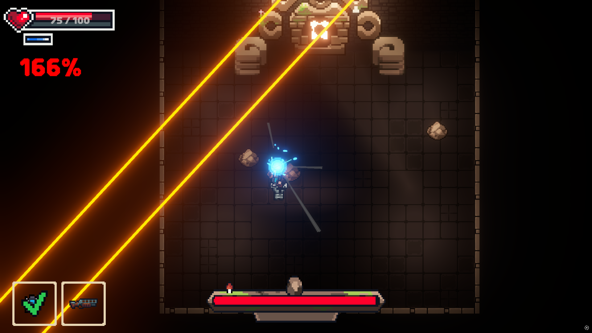
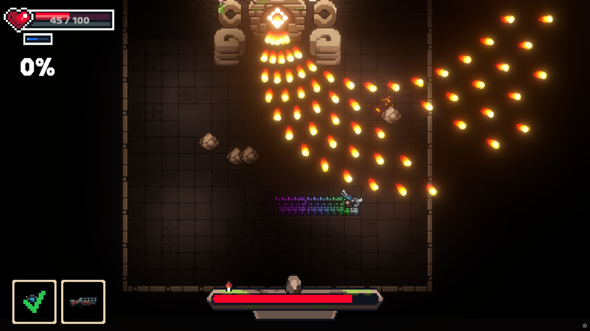
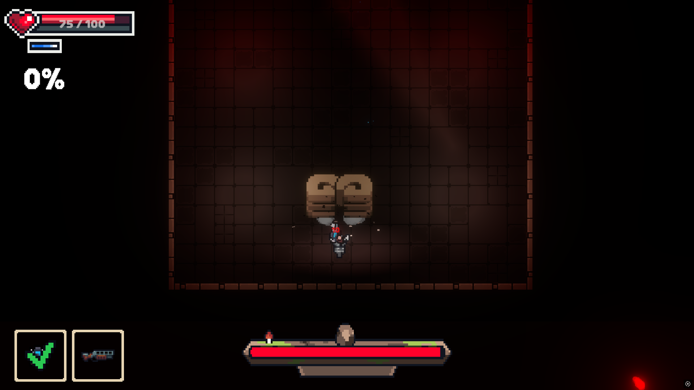

# Chasing Phasing

> 📌 Enter the Gungeon에서 영감을 받은 보스 러시형 탄막 게임입니다. 차징을 활용해 보스를 처치하는 것이 목표입니다.

<p align="left">
  
  
  
</p>

🔗 [문서](https://abaft-yarn-52e.notion.site/Chasing-Phasing-1d5c32f25528802d9470c121a81b270c?pvs=74)

이 폴더의 코드는 모두 제가 직접 작성한 부분입니다.

---

## 📂 폴더 구조

```
ChasingPhasing/
├── BT/          # Behavior Tree 노드 · 그래프
├── GolemBoss/   # 골렘 보스 패턴
├── Particle/    # 이펙트 · 풀링
├── Portal/      # 포탈
├── Dummy/       # 테스트용 더미
├── FadeOut.cs   # 씬 전환 페이드
└── HitStop.cs   # 히트스톱
```

---

## 🔹 핵심 구조

### 보스 AI — `BT/`, `GolemBoss/`
- Behavior Tree가 보스 상태에 따라 패턴을 선택하고, 각 패턴은 독립된 Action 노드로 모듈화했습니다.
- 실제 패턴 동작은 `GolemBoss.cs`가 중앙에서 관리하고, 주먹 · 총알 패턴은 `GolemBossHandPattern` / `GolemBossBulletPattern`으로 분리했습니다.
- 패턴이 끝나면 `PatternEnd` 이벤트 채널로 그래프에 다음 패턴 진행을 알립니다.

### 연출 — `Particle/`, `HitStop.cs`, `FadeOut.cs`
- 공격 · 피격 이펙트는 `IPoolable` 기반 풀링으로 관리합니다.
- 일정 데미지 이상에서만 히트스톱을 걸어 타격감을 강조하고, 씬 전환은 페이드로 처리합니다.

### 설계 방향
- 싱글톤 없이 이벤트 기반으로 UI · 파티클을 연결해 의존성을 줄이고 테스트하기 쉬운 구조로 만들었습니다.
