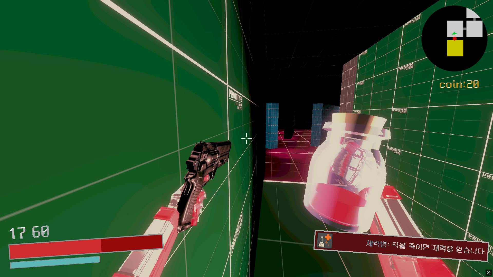
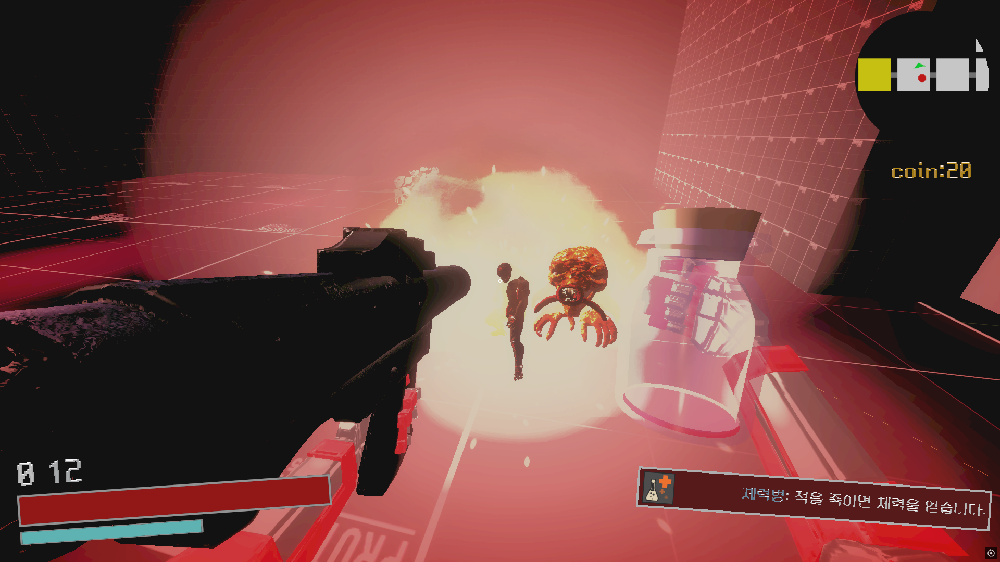
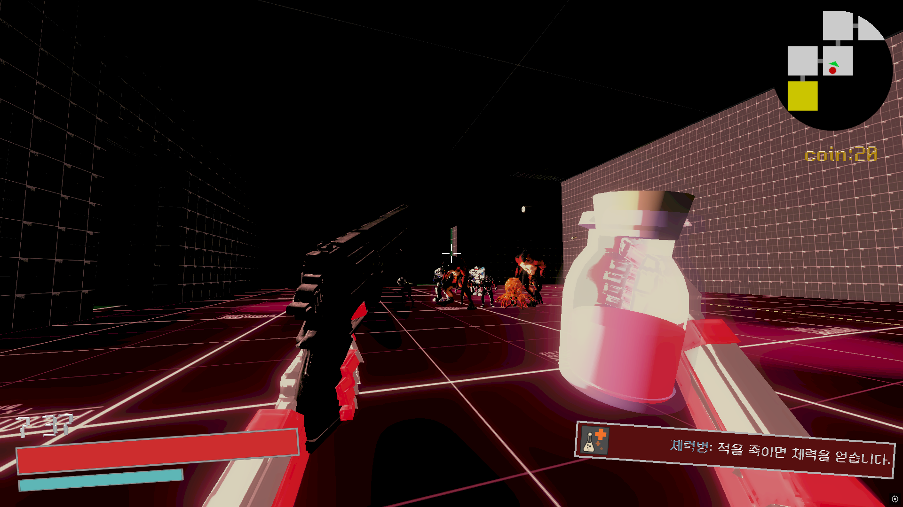

# GUAKE

> 📌 BPM, QUAKE에서 영감을 받은 FPS 로그라이크 게임입니다. 다양한 병을 활용해 전략적으로 적을 처치하며 생존하는 것이 목표입니다.

<p align="left">
  
  
  
</p>

🔗 [문서](https://abaft-yarn-52e.notion.site/GUAKE-1d5c32f255288025902fe200684334e0)

이 폴더의 코드는 모두 제가 직접 작성한 부분입니다.

---

## 📂 폴더 구조

```
GUAKE/
├── Core/        # 맵 생성, 체력, 풀링, UI, 사운드
├── Gun/         # 총기
├── Enemy/       # 적 AI (FSM)
├── Bottle/      # 병 아이템
├── Stat/        # 플레이어 스탯
├── SO/          # ScriptableObject 데이터
└── MainMenu/    # 타이틀
```

---

## 🔹 핵심 구조

### 절차적 맵 생성 — `Core/Room/`
- `MapManager`가 챕터 단위로 방(`Room`)과 길(`Corridor`)을 무작위로 연결해 매번 다른 맵을 만듭니다.
- 각 방은 `RoomType`과 `EnemySettings`를 가지며, 적은 `EnemyMapSetting` 인터페이스로 소속 방에 등록 · 제거됩니다.

### 총기 — `Gun/`, `SO/GunDataSO.cs`
- 공통 로직은 `Gun` 추상 클래스, 수치는 `GunDataSO`로 분리했습니다.
- 총기별 클래스에서 발사(캐스팅) 방식만 재정의해 새 총기를 쉽게 추가할 수 있습니다.

### 적 AI — `Enemy/`
- `EnemyState` / `EnemyStateMachine` 기반 FSM으로 대기 · 추적 · 공격 · 도주 · 사망 상태를 정의했습니다.
- 같은 상태라도 공격 컴포넌트(`EnemyShot`, `EnemyExplosion` 등)를 바꿔 몬스터마다 다른 행동을 하도록 했습니다.

### 병 · 스탯 — `Bottle/`, `Stat/`
- `Bottle` 추상 클래스를 상속해 병마다 효과를 구현하고, 효과는 `PlayerStatController`를 통해 스탯에 반영됩니다.

### UI — `Core/UI/`
- `UIManager`가 HUD, 병 상태, 피격 블러드 스크린 등 UI를 한 곳에서 관리합니다.
