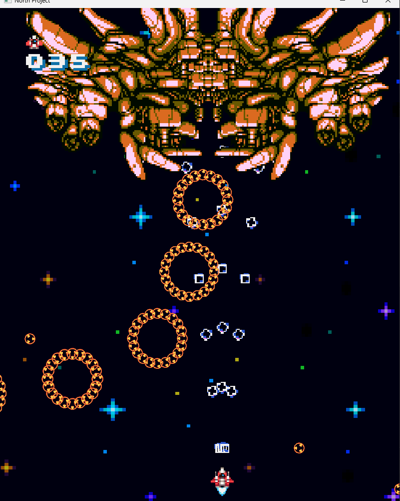
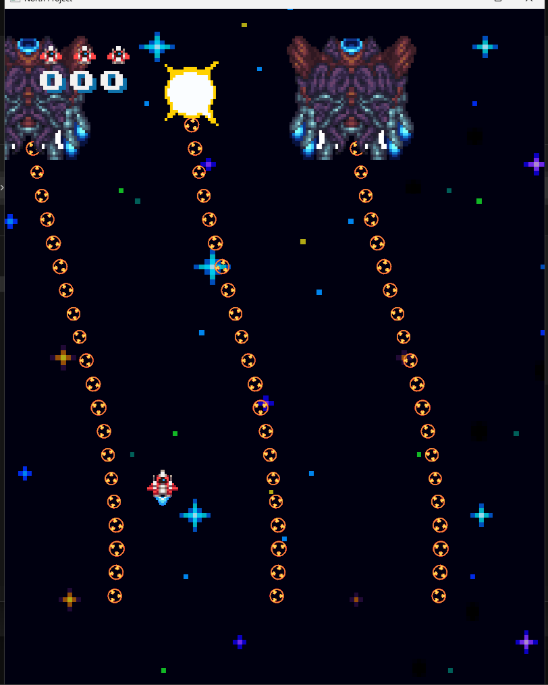
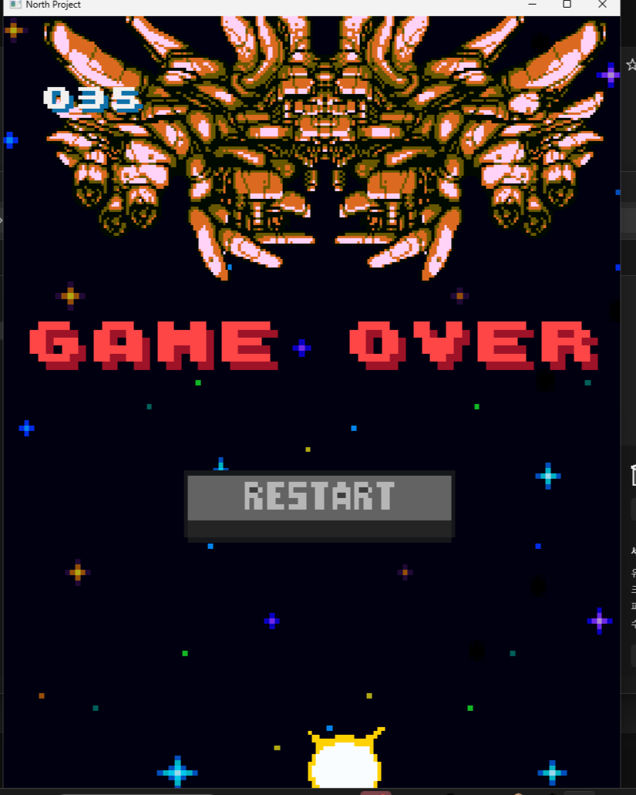

# North Project

> 📌 동방 프로젝트에서 영감을 받은 슈팅 게임으로, 다양한 탄막 패턴을 피해 보스를 처치하는 것이 목표입니다.

<p align="left">
  
  
  
</p>

🔗 [문서](https://abaft-yarn-52e.notion.site/NortProject-1d5c32f25528804aab63d155d69cf811?pvs=74)

이 폴더의 코드는 모두 제가 직접 작성한 부분입니다.

---

## 📂 폴더 구조

```
NorthProject/
├── Bullet/      # 탄막 · 탄환
├── Enemy/       # 일반 적 · 보스
├── UI/          # UI · 버튼
├── Scene/       # 타이틀 · 게임 · 보스 씬
├── Camera/      # 카메라
├── Background   # 무한 스크롤 배경
└── Item         # 레벨업 아이템
```

---

## 🔹 핵심 구조

### 탄막 — `Bullet/`
- `BulletManager`에 `BasicShot`, `CircleShot`, `CircleShotGoToTarget`, `ShapeShot`, `SpinShot`, `HeartShot`, `HeartShotGoToTarget`, `RoseShot`, `RoseSpinShot` 9가지 패턴을 구현하고, 적마다 자유롭게 조합해 사용합니다.
- `Projectile`은 자체 조건으로 스스로 파괴되어 별도 관리 비용이 없고, 상속으로 일반 · 유도 탄환을 확장합니다.

### UI — `UI/`
- 모든 UI는 `UI` 클래스를 상속하고, `UIManager`(싱글톤)가 전체 흐름을 관리합니다.
- `Button`은 마우스 상태별 이벤트를 처리하며, 용도별 버튼은 이를 상속해 동작만 정의합니다.

### 씬 — `Scene/`
- 타이틀 · 게임 · 보스 씬을 분리하고, 재시작 시 씬 내 오브젝트를 정리해 깨끗한 상태로 돌아갑니다.
